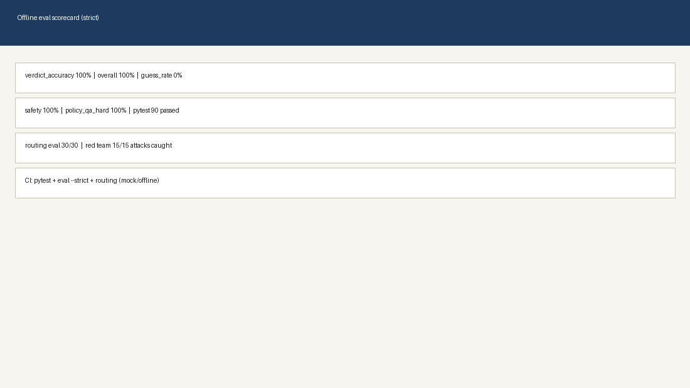
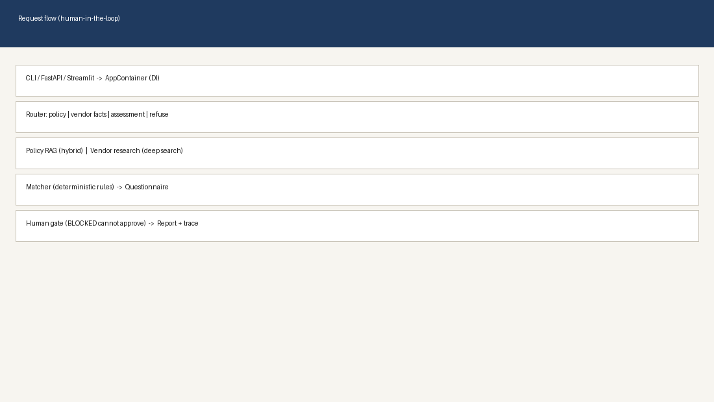
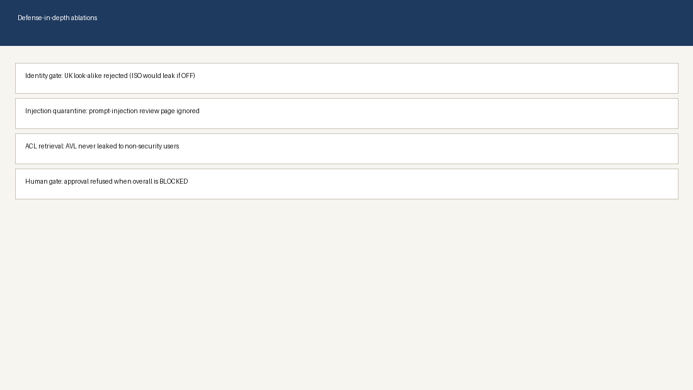
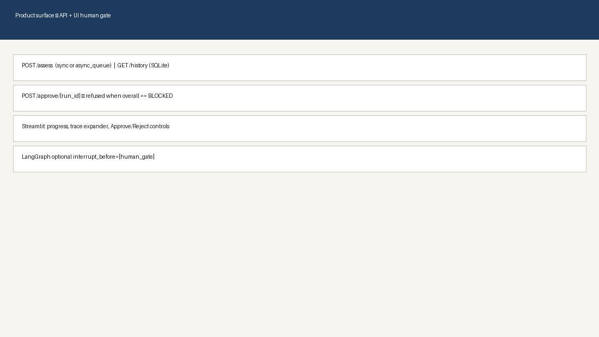
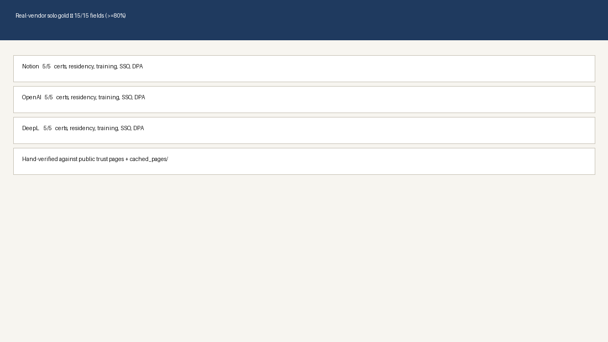

# AI Vendor Risk Assessor

[](https://github.com/dnyaneshwarmagar/ai-vendor-risk-assessor/actions/workflows/ci.yml)

**Portfolio capstone by [Dnyaneshwar Magar](https://github.com/dnyaneshwarmagar)**

> *“Can our support team use LedgerLens AI with customer tickets?”*  
> The assessor reads company policies, researches the vendor, checks every requirement with **deterministic rules**, drafts vendor questions, and hands a review pack to a **human approver**. The LLM never approves anything.

**Story:** I automated the vendor security review — and kept it honest.



---

## Results (quoteable)

| Check | Result |
|---|---|
| Unit tests | **90 passed** |
| Fictional gold (`eval --strict`) | verdict/overall/safety/policy_qa **100%**, **guess_rate 0%** |
| Routing eval | **30/30** |
| Red team | **15/15** with named catch points |
| Real-vendor solo gold (Notion, OpenAI, DeepL) | **15/15 fields (100%)** hand-verified ≥80% target |
| Product | FastAPI + Streamlit; **BLOCKED cannot be approved** |

Reports: [`reports/eval_report.md`](reports/eval_report.md) · [`reports/eval_report_real.md`](reports/eval_report_real.md) · [`reports/ablation_report.md`](reports/ablation_report.md)

---

## What it does

```text
Question
   │
   ▼
guard → router ──► policy RAG (hybrid BM25+TF-IDF + graders)
              ├──► vendor facts only
              └──► research → matcher (rules) → questionnaire → human gate → report
```



**Non‑negotiables**

1. The LLM never decides a verdict — `matcher.py` does.  
2. UNKNOWN beats a guess.  
3. Claims ≠ evidence (documented vs claimed).  
4. Identity is a gate; injections are quarantined.  
5. ACL lives in retrieval.  
6. Humans approve.



---

## Quick start (offline)

```bash
python -m venv .venv
# Windows: .venv\Scripts\Activate.ps1
pip install -r requirements.txt
copy .env.example .env          # defaults: LLM_PROVIDER=mock, SEARCH_PROVIDER=offline
python scripts/check_setup.py
python run_assessor.py          # LedgerLens T3 → BLOCKED
```

```bash
python -m pytest tests -q
python eval/run_eval.py --strict
python eval/run_routing_eval.py
```

### Demo script

Full 12‑minute interview arc + 2–3 min video cut: [`docs/DEMO_SCRIPT.md`](docs/DEMO_SCRIPT.md)  
Sample BLOCKED report: [`docs/samples/ledgerlens-t3-blocked-report.md`](docs/samples/ledgerlens-t3-blocked-report.md)  
Screenshots: [`docs/screenshots/`](docs/screenshots/)  
Resume bullets: [`docs/RESUME_BULLETS.md`](docs/RESUME_BULLETS.md)  
Demo video link: [`docs/demo-video.url`](docs/demo-video.url) *(paste your Loom/YouTube URL after recording)*

### Product surface

```bash
uvicorn app.api:app --reload --port 8000   # Swagger at /docs
streamlit run app/ui.py
```



---

## Live LLM (Ollama → Groq/cloud)

All traffic goes through [`assessor/providers.py`](assessor/providers.py) — change `.env` only:

| Role | Example |
|---|---|
| Generate | `LLM_PROVIDER=ollama` · `LLM_MODEL=qwen2.5:3b` |
| Ragas judge | `LLM_JUDGE_MODEL=qwen2.5:7b` |
| Production | `LLM_PROVIDER=groq` + `GROQ_API_KEY` |

```bash
python eval/run_ragas_eval.py --case pq-residency
python eval/run_real_eval.py --gold-only
# live crawl (optional): SEARCH_PROVIDER=ddgs + live LLM → eval/run_real_eval.py --live
```



---

## Architecture (OOP + DI)

```text
CLI / FastAPI / Streamlit
        │
        ▼
 AppContainer  (assessor/container.py)
        │
        ▼
 AssessmentService  → ports: LLM, Policy, Research, Router, Graders, Guards, Matcher, Store
```

---

## Honest failures

1. **Small local models** (`qwen2.5:3b`) often break structured `ResearchPlan` JSON — we fall back to a deterministic planner instead of inventing bad queries.  
2. **Ragas Faithfulness** on short packed contexts can look weak even when matcher verdicts are correct — release gates are strict fictional eval + red team, not Ragas.

---

## Attribution

Capstone brief and course kits inspired by **Shivank Agrawal · Future with Shivank** (see `Capstone-AI-Vendor-Risk-Assessor-Shivank-Agrawal.html` and `other_three_sub_projects/`). Implementation, packaging, and evaluation in this repository are by **Dnyaneshwar Magar**.

Fictional vendors/policies in `data/` are course-written. Real-vendor gold in `data/gold_set_real_solo.json` is hand-checked against public pages — re-verify before production use.

License: [MIT](LICENSE)
